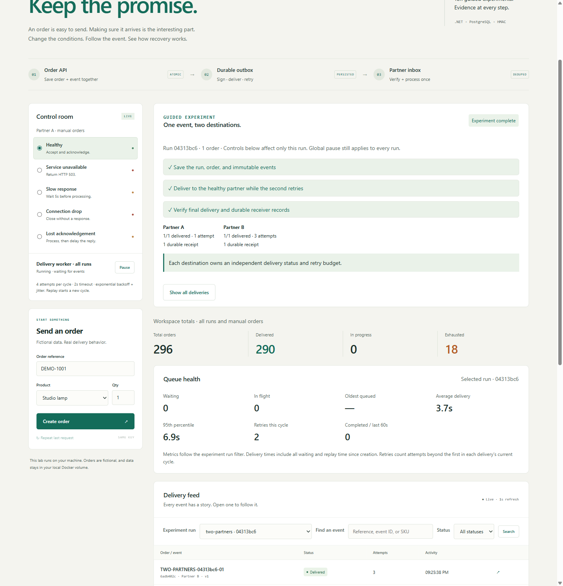
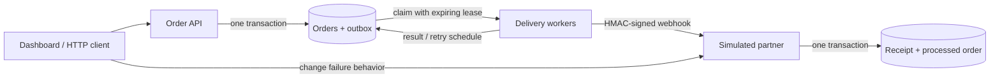

# Octo Integration Lab

[](https://github.com/OctoHoldingsLLC/octo-integration-lab/actions/workflows/ci.yml)
[](LICENSE)

**Break the connection. Keep the promise.**

A hands-on .NET lab for exploring durable webhooks, idempotency, retries, and failure recovery. Create a fictional order, break the simulated partner API, and follow the event from the outbox to the receiver's durable inbox.



## Run it

Install [Docker Desktop](https://www.docker.com/products/docker-desktop/) or Docker Engine with Compose. No local .NET SDK, database, or Node.js installation is needed.

```sh
git clone https://github.com/OctoHoldingsLLC/octo-integration-lab.git
cd octo-integration-lab
docker compose up -d --build --wait
```

Open **http://localhost:5188**. The first build downloads the .NET and PostgreSQL images. Subsequent starts reuse them. If the port is taken, set `LAB_PORT` in an `.env` file; see [.env.example](.env.example).

Only the lab's port is published, bound to localhost. Both services run as a non-root user. Orders, event payloads, attempts, receiver receipts, and controls live in a named PostgreSQL volume and survive container restarts.

## Try the experiments

| Experiment           | What to do                                                                                        | What you should see                                                                                                      |
| -------------------- | ------------------------------------------------------------------------------------------------- | ------------------------------------------------------------------------------------------------------------------------ |
| Healthy delivery     | Create an order with **Healthy** selected.                                                        | One accepted delivery and one processed order.                                                                           |
| Retry and recover    | Start **Let it fail. Then fix it.** Wait for a failed attempt, then select **Healthy**.           | A 503 followed by a successful retry of the same event.                                                                  |
| Lost acknowledgement | Start **The reply never arrived.**                                                                | The partner commits the order, but the sender times out. Its retry is marked **Duplicate**. Only one order is processed. |
| Slow receiver        | Select **Slow response**, then create an order. Switch to **Healthy**.                            | Bounded timeouts, followed by recovery.                                                                                  |
| Dropped connection   | Select **Connection drop**, then create an order.                                                 | A network failure rather than an HTTP error; the event stays eligible for retry.                                         |
| Retry exhaustion     | Leave **Service unavailable** selected through four attempts.                                     | **Exhausted**. Select **Healthy**, open the event, and choose **Replay event** to start a fresh cycle.                   |
| API idempotency      | Create an order, then choose **Repeat last request**.                                             | The original order and event IDs return; total orders do not increase.                                                   |
| Persistence          | Start **Put delivery on hold.** Run `docker compose restart lab`, refresh, and resume the worker. | The pause setting and pending event survive. Resuming delivers it.                                                       |

Replay also works on delivered events, making receiver deduplication easy to inspect. It preserves the event ID, payload, and earlier attempts. Search and filter the paginated feed, or open a saved event link directly. The inspector offers both readable JSON and the exact transmitted body with its SHA-256 hash.

The **On the other side** counters come from the separate partner service's durable receipt and order tables. They measure receiver-side effects, not just sender-side success responses.

## How it works



- **Atomic publishing:** saving an order and its event is one PostgreSQL transaction.
- **Durable scheduling:** three worker loops claim due events with `FOR UPDATE SKIP LOCKED`. Network calls happen outside the transaction.
- **Crash recovery:** an expiring lease makes abandoned work claimable again. A claim token prevents a stale worker from overwriting a newer result.
- **Bounded retries:** four attempts per cycle, a two-second request timeout, and exponential backoff with jitter. Transient errors retry; permanent HTTP errors exhaust immediately.
- **Stable messages:** the event ID and stored JSON stay unchanged across retries and manual replay. Each request gets a fresh timestamp and HMAC-SHA256 signature.
- **Durable deduplication:** the partner commits its receipt and fictional business effect together. Duplicate events with matching content are acknowledged without processing the order again.
- **Inspectable failures:** failed, timed-out, interrupted, accepted, and duplicate attempts appear in the timeline. An interrupted attempt is explicitly an unknown outcome.

Delivery is **at least once**. A sender cannot infer from a timeout whether the receiver committed an order. The receiver's unique event ID and transaction make repeat deliveries safe for this workflow. This is not a claim of exactly-once network delivery.

Read the [architecture and tradeoffs](docs/architecture.md), [HTTP API and signing contract](docs/api.md), and [experiment walkthroughs](docs/experiments.md).

## Verify it

Run unit tests and the integration suite against real PostgreSQL and both HTTP services:

```sh
docker compose --profile test run --build --rm tests
```

The suite covers concurrent API requests, transaction rollback, competing workers, stale claim fencing, signature tampering, replay protection, timeouts, connection loss, exhaustion, and receiver deduplication. It uses fictional records and changes the lab's controls, so run it on a dedicated local instance.

To also kill and restart a real container while a delivery is in flight:

```sh
pwsh -File scripts/verify-recovery.ps1
```

This check verifies queued-event persistence, kills the sender after the receiver commits but before its reply, and then checks lease recovery, the interrupted attempt, and a single receiver-side business effect. It requires PowerShell 7 and the running Compose stack. Set `-BaseUrl http://127.0.0.1:YOUR_PORT` when overriding the lab port. GitHub Actions runs both checks.

For local .NET development, install a .NET 10 SDK, run `dotnet build`, or run isolated tests with:

```sh
dotnet test --filter Category=Unit
```

Browser checks require Node.js for development only. Against a dedicated running stack:

```sh
npm ci
npx playwright install chromium
npm run test:browser
```

Set `LAB_BASE_URL` when using a different port. These tests exercise reload recovery after a lost API response, direct event links, filtering, replay, keyboard operation, and accessibility at four viewport widths. Reports and screenshots go into ignored `output/playwright/`. The dashboard itself still needs no frontend build.

Use [.env.example](.env.example) and the environment entries in [compose.yaml](compose.yaml) when running the hosts directly. Integration tests require `LAB_BASE_URL`, `PARTNER_BASE_URL`, `ConnectionStrings__Lab`, and the matching `SigningSecret`; the Compose test service sets these automatically.

## Stop or reset

```sh
docker compose down
```

This stops the lab and retains its database. To **delete this lab's data** and start fresh:

```sh
docker compose down --volumes
docker compose up -d --build --wait
```

## Scope

This is an educational reference implementation with one fictional `order.confirmed` workflow. It has no authentication, billing, real partner integrations, tenant management, or production deployment configuration. Default keys are intentionally public demo values. Keep it local and use fictional data. See [SECURITY.md](SECURITY.md) for the operating boundary.

The schema is upgraded on startup using [transactional, checksummed migrations](docs/migrations.md). Existing first-release data is preserved. Delivery ordering, historical data retention, throughput guarantees, and distributed rate limiting are outside this version's scope.

## Built by Octo

Octo builds custom software, integrations, and modernization projects. This lab makes the engineering behind reliable integrations visible and reusable.

[Octo Holdings](https://octoholdings.com) · [Contributing](CONTRIBUTING.md) · [MIT license](LICENSE)
