# Architecture and guarantees

The lab uses two independent ASP.NET Core hosts and one PostgreSQL instance. The hosts own separate tables; the shared instance makes local setup small. `src/Lab` never writes the partner's business records, and `src/Partner` never edits the outbox. They communicate over HTTP.

## Order creation

`POST /api/orders` requires an idempotency key. Validation runs before persistence. Inside one transaction, the API inserts an order with a unique key and a hash of its normalized request, then writes an immutable `order.confirmed` JSON payload to `lab_deliveries`.

The unique key serializes concurrent duplicate requests. A matching request returns the existing order and event IDs. Reusing a key with different content returns 409. If the outbox insert fails, the order insert rolls back. There is no interval in which a committed order exists without its outbox event.

## Dispatch lifecycle

```mermaid
stateDiagram-v2
    [*] --> Pending: order transaction commits
    Pending --> Delivering: claim + attempt recorded
    Retrying --> Delivering: retry becomes due
    Delivering --> Delivered: HTTP 2xx
    Delivering --> Retrying: transient failure; budget remains
    Delivering --> Exhausted: permanent failure or budget spent
    Delivering --> Retrying: lease expires; budget remains
    Delivering --> Exhausted: final attempt's lease expires
    Delivered --> Pending: manual replay
    Exhausted --> Pending: manual replay
```

Three asynchronous loops share a singleton, thread-safe Npgsql data source. Each claim uses `FOR UPDATE SKIP LOCKED`, allowing competing loops or processes to work without claiming the same due row. A short transaction records the attempt, increments the counters, assigns a random claim token, and sets a lease. It commits **before** the HTTP request.

No transaction or row lock is held during network I/O. The result updates the delivery and attempt together, conditional on the claim token still matching. If an old process wakes after its lease was recovered, it cannot overwrite a newer result. The sender's two-second timeout is shorter than its fifteen-second lease.

Recovery marks abandoned attempts **Interrupted**, preserving that their receiver-side outcome is unknown. These attempts count toward the retry budget. Recovery of the final attempt exhausts the event instead of silently sending an extra request. Manual replay resets the per-cycle budget and increments a replay counter; total attempt numbers and history continue.

Pausing prevents new claims. Already in-flight requests may finish. The pause flag is persisted; it survives restarts. Due times use the database clock, while signed timestamps use the sender clock. Real deployments need synchronized clocks.

## HTTP outcomes and retries

| Outcome                                | Policy                                                          |
| -------------------------------------- | --------------------------------------------------------------- |
| Any 2xx response                       | Delivered; response JSON is optional diagnostics.               |
| 408, 425, 429, 5xx                     | Retry while the cycle has attempts remaining.                   |
| Timeout, connection error              | Retry; receiver-side outcome may be unknown.                    |
| Other HTTP status, including redirects | Exhaust immediately; redirects are not followed.                |
| Expired lease                          | Mark the unfinished attempt interrupted, then retry or exhaust. |

The default cycle has four attempts. Delays after attempts 1–3 are approximately 2–2.5, 4–5, and 8–10 seconds. The policy caps delays at 60 seconds. This version does not implement `Retry-After` or per-destination rate limits.

HTTP clients disable automatic redirects, cookies, and proxies. The target is a single operator-configured origin, never a browser-supplied URL. Only a small optional response body is read for the partner's duplicate flag; a malformed or large body cannot turn a 2xx acknowledgement into another delivery attempt. Logs include event IDs and outcomes, not request payloads or secrets.

## Receiver transaction

The partner verifies the timestamped HMAC before applying a failure mode or touching a business record. It checks that the signed event ID matches the event payload and validates the fictional order fields.

A unique `partner_receipts.event_id` enforces deduplication. In one transaction the partner writes both that receipt and a `partner_orders` record representing the business effect. Concurrent duplicates wait for the winning transaction, compare payload hashes, increment a diagnostic duplicate counter, and return success without repeating the effect. Conflicting content under an existing ID returns 409. A separate unique order ID prevents a new event ID from silently creating the same order again.

In **Lost acknowledgement**, the transaction commits before the response is delayed. The sender times out; its retry finds the receipt and succeeds as a duplicate. The signature timestamp alone does not prevent a valid message from being replayed inside its five-minute window. Durable inbox uniqueness does.

## Observability and storage

`lab_attempts` records the start, completion, outcome, HTTP status, elapsed duration, and a bounded explanatory message for each attempt. All event bytes live in `lab_deliveries.payload` and are immutable in normal application operations. The dashboard reads counts from the entire dataset and lists the newest 100 events.

An interrupted attempt has no reliable duration or HTTP status. The timeline keeps those values absent instead of inventing a failure response. Results from a stale claim are intentionally ignored.

The partner's processed count is queried independently through its control API. Sender delivery and receiver processing can temporarily disagree; that is the point of the lost-acknowledgement experiment. Database snapshots and partner counters are not a distributed transaction.

## Deliberate limits

- One event type and one configured partner; no ordering guarantee between events.
- Three concurrent requests per host, no distributed concurrency cap.
- Shared local database server and demo credentials; no tenant boundary or production key lifecycle.
- No pruning, encrypted payload store, metrics backend, alerting, automatic deployment, or production SLA.
- Startup DDL initializes this version's schema; it is not a migration system.
- Schema ownership and unrestricted demo controls are suitable for this localhost lab. A deployed service needs authentication, least-privilege database roles, and an explicit operating model.

The SQL is deliberately visible in the store classes. The goal is to make transaction boundaries and failure behavior easy to inspect. See the [tests](../tests/Lab.Tests) for executable counterexamples, including rollback, claim races, final-attempt abandonment, and stale-result fencing.
