# Architecture and guarantees

The lab uses one sender and two independent ASP.NET Core partner hosts with one PostgreSQL instance. Partner A uses the public schema; Partner B uses partner_secondary. The hosts own separate tables; the shared instance makes local setup small. `src/Lab` never writes the partner's business records, and `src/Partner` never edits the outbox. They communicate over HTTP.

## Order creation

`POST /api/orders` requires an idempotency key. Validation runs before persistence. Inside one transaction, the API inserts an order with a unique key and a hash of its normalized request, then writes an immutable `order.confirmed` JSON payload to `lab_events` and its delivery to `lab_deliveries`.

The unique key serializes concurrent duplicate requests. A matching request returns the existing order and event IDs. Reusing a key with different content returns 409. If the outbox insert fails, the order insert rolls back. There is no interval in which a committed order exists without its outbox event.

## Dispatch lifecycle

```mermaid
stateDiagram-v2
    [*] --> Pending: order transaction commits
    Pending --> Delivering: claim + attempt recorded
    Retrying --> Delivering: retry becomes due
    Delivering --> Delivered: HTTP 2xx
    Delivering --> Retrying: transient failure; budget remains
    Delivering --> Exhausted: permanent failure or budget spent
    Delivering --> Retrying: lease expires; budget remains
    Delivering --> Exhausted: final attempt's lease expires
    Delivered --> Pending: manual replay
    Exhausted --> Pending: manual replay
```

Three asynchronous loops share a singleton, thread-safe Npgsql data source. Each claim uses `FOR UPDATE SKIP LOCKED`, allowing competing loops or processes to work without claiming the same due row. A short transaction records the attempt, increments the counters, assigns a random claim token, and sets a lease. It commits **before** the HTTP request.

No transaction or row lock is held during network I/O. The result updates the delivery and attempt together, conditional on the claim token still matching. If an old process wakes after its lease was recovered, it cannot overwrite a newer result. The sender's two-second timeout is shorter than its fifteen-second lease.

Recovery marks abandoned attempts **Interrupted**, preserving that their receiver-side outcome is unknown. These attempts count toward the retry budget. Recovery of the final attempt exhausts the event instead of silently sending an extra request. Manual replay resets the per-cycle budget and increments a replay counter; total attempt numbers and history continue.

Pausing prevents new claims. Already in-flight requests may finish. The pause flag is persisted; it survives restarts. Due times use the database clock, while signed timestamps use the sender clock. Real deployments need synchronized clocks.

## HTTP outcomes and retries

| Outcome                                | Policy                                                          |
| -------------------------------------- | --------------------------------------------------------------- |
| Any 2xx response                       | Delivered; response JSON is optional diagnostics.               |
| 408, 425, 429, 5xx                     | Retry while the cycle has attempts remaining.                   |
| Timeout, connection error              | Retry; receiver-side outcome may be unknown.                    |
| Other HTTP status, including redirects | Exhaust immediately; redirects are not followed.                |
| Expired lease                          | Mark the unfinished attempt interrupted, then retry or exhaust. |

The default cycle has four attempts. Delays after attempts 1–3 are approximately 2–2.5, 4–5, and 8–10 seconds. The policy caps delays at 60 seconds. For 429 and 503 responses, Retry-After accepts nonnegative seconds or an HTTP date. The greater of local backoff and the receiver delay wins. Invalid values fall back to local backoff; excessive values are capped at 60 seconds with an explicit attempt explanation. Per-destination rate limits are not implemented.

HTTP clients disable automatic redirects, cookies, and proxies. The two destinations are fixed operator-configured origins, never browser-supplied URLs. Only a small optional response body is read for the partner's duplicate flag; a malformed or large body cannot turn a 2xx acknowledgement into another delivery attempt. Logs include event IDs and outcomes, not request payloads or secrets.

## Receiver transaction

The partner verifies the timestamped HMAC before applying a failure mode or touching a business record. It checks that the signed event ID matches the event payload and validates the fictional order fields.

A unique `partner_receipts.event_id` enforces deduplication. In one transaction the partner writes both that receipt and a `partner_orders` record representing the business effect. Concurrent duplicates wait for the winning transaction, compare payload hashes, increment a diagnostic duplicate counter, and return success without repeating the effect. Conflicting content under an existing ID returns 409. A unique order ID and conditional version update prevent duplicate or stale events from repeating or reversing the business effect.

In **Lost acknowledgement**, the transaction commits before the response is delayed. The sender times out; its retry finds the receipt and succeeds as a duplicate. The signature timestamp alone does not prevent a valid message from being replayed inside its five-minute window. Durable inbox uniqueness does.

## Observability and storage

Guided runs are created atomically with their orders, events, and destination deliveries. Run requests have independent idempotency keys. Signed event metadata identifies the run and scenario; the receiver uses a durable request counter for repeatable failures. A receiver override affects only that run. Manual receiver controls apply to events without a run. The global worker pause applies to both manual events and runs; a run's own pause affects only that run.

The same immutable event can have one delivery per destination. Each delivery has its own lease, claim token, attempts, status, and retry budget. Partner A and Partner B have separate durable stores. The primary delivery retains the event UUID as its delivery UUID for compatibility; secondary deliveries have distinct delivery UUIDs but transmit the original signed event UUID.

The ordering experiment creates a version-one confirmation and a version-two cancellation, delaying the former's initial delivery. The receiver applies a version only when it is newer than the stored order version. An older event gets a durable receipt marked Stale and a successful acknowledgement without overwriting the order. A different event reusing the same order version conflicts. Receipt, version comparison, conditional order update, and observation share a transaction.

The circuit experiment adds a durable gate scoped to its run and destination. Two transient failures open it for five seconds. Already claimed requests may finish. Open gates suppress new claims without incrementing attempt counters. After the wait, a row lock admits one leased HalfOpen probe. Success closes the gate; another transient failure reopens it. An expired probe can be replaced, and the delivery's claim-token fence prevents its stale result from changing either delivery or circuit state. No network call occurs inside a database transaction.

Run completion is derived from delivery records, failed attempts, and independently fetched receiver evidence. Missing receiver evidence leaves a run unverified. The permanent-rejection experiment completes by verifying exhaustion and the absence of a committed receipt. Timelines merge real sender and receiver observations by their timestamps; they are not a distributed snapshot and assume sufficiently synchronized clocks.

`lab_attempts` records the start, completion, outcome, HTTP status, elapsed duration, and a bounded explanatory message for each attempt. All event bytes live in `lab_events.payload` and are immutable in normal application operations. The dashboard reads global counts and searches, filters, and paginates deliveries. Detail endpoints do not depend on the current page.

Queue metrics query the same durable delivery records, globally or for one run. OpenTelemetry context is stored beside event bytes and restored by each worker attempt, including after restart. HTTP instrumentation propagates the trace to the appropriate partner; attempt and observation records retain the correlation ID. Export to a local collector is optional and has no role in deciding whether a run completed. See [observability](observability.md) for metric definitions, collector setup, and the exported-trace check.

An interrupted attempt has no reliable duration or HTTP status. The timeline keeps those values absent instead of inventing a failure response. Results from a stale claim are intentionally ignored.

The partner's processed count is queried independently through its control API. Sender delivery and receiver processing can temporarily disagree; that is the point of the lost-acknowledgement experiment. Database snapshots and partner counters are not a distributed transaction.

## Deliberate limits

- Two order event versions and two fixed configured partners; no transport ordering guarantee.
- Three concurrent requests per host, no distributed concurrency cap.
- Shared local database server and demo credentials; no tenant boundary or production key lifecycle.
- No pruning, encrypted payload store, metrics backend, alerting, automatic deployment, or production SLA.
- Transactional migrations upgrade each service schema and refuse modified migration history.
- Schema ownership and unrestricted demo controls are suitable for this localhost lab. A deployed service needs authentication, least-privilege database roles, and an explicit operating model.

The SQL is deliberately visible in the store classes. The goal is to make transaction boundaries and failure behavior easy to inspect. See the [tests](../tests/Lab.Tests) for executable counterexamples, including rollback, claim races, final-attempt abandonment, and stale-result fencing.
